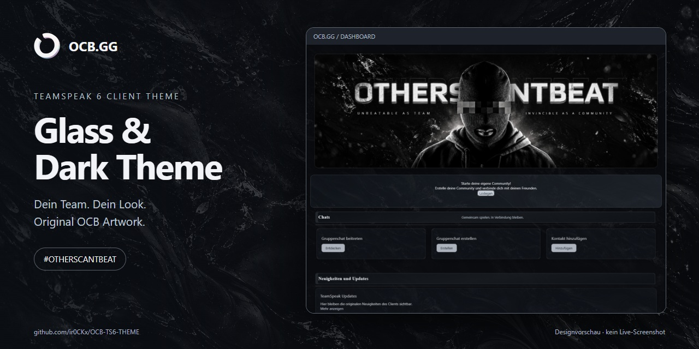
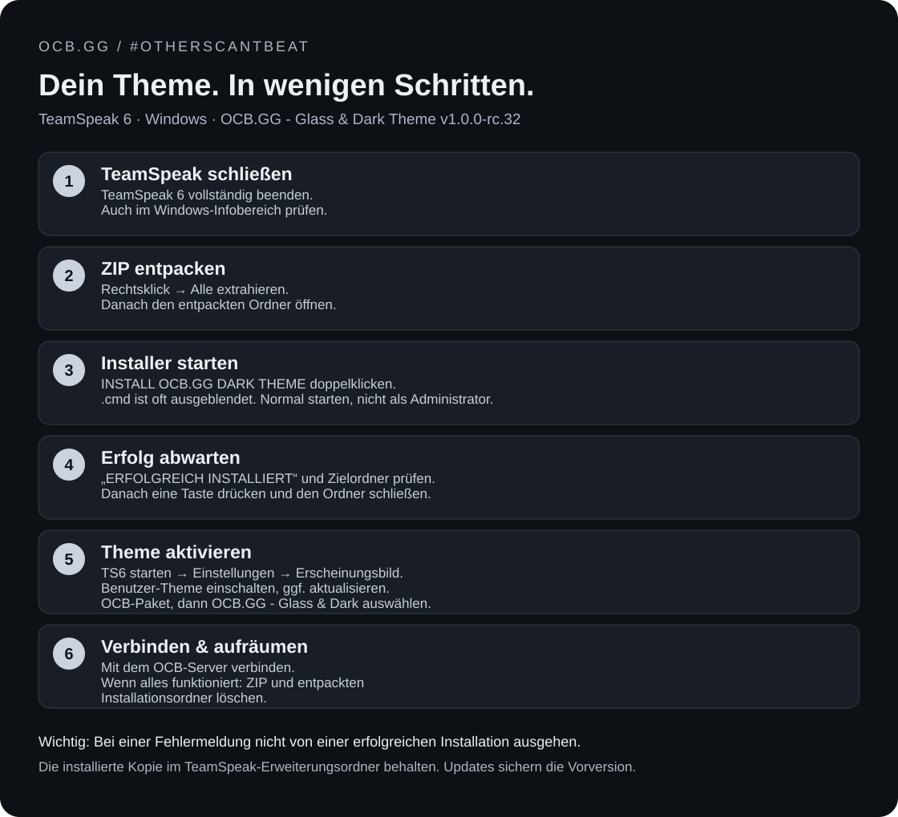
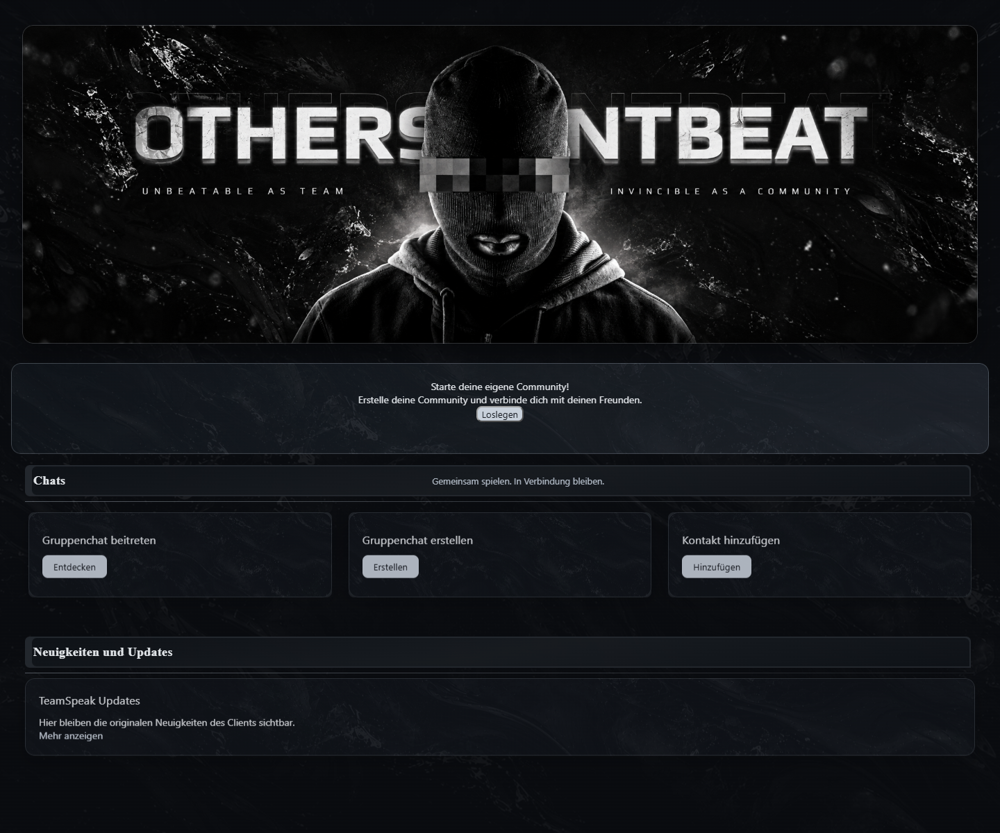
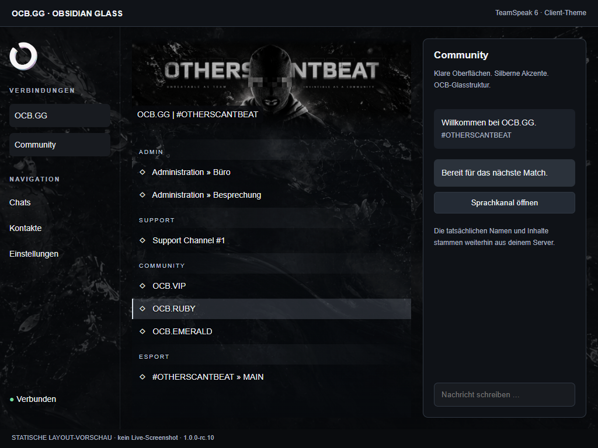

# OCB.GG - Glass & Dark Theme v1.0.0-rc.31

TeamSpeak-6-Client-Theme von **#OTHERSCANTBEAT / OCB.GG**. Dunkle Oberflächen, silberne Akzente, originaler OCB-Kopfbanner und ein durchgehendes Glas-/Wellenmotiv hinter dem Kanalbaum.

**Aktuelle Version: 1.0.0-rc.31** · Windows-Installer inklusive.

[**Download: vollständiges Theme-Paket**](https://github.com/ir0CKx/OCB-TS6-THEME/raw/refs/heads/main/downloads/OCB.GG-Glass-Dark-Theme-v1.0.0-rc.31.zip)

## Download-Inhalt

- **START HIER.html** – bebilderte Offline-Anleitung im Browser.
- **INSTALL OCB.GG DARK THEME.cmd** – installieren oder aktualisieren.
- **DIAGNOSE OCB.GG DARK THEME.cmd** – Probleme prüfen, ohne Änderungen.
- **UNINSTALL OCB.GG DARK THEME.cmd** – installierte Kopie sichern und entfernen.
- **Anleitung/** – Details, Nutzungsbedingungen und Änderungen.
- **Daten/** – benötigte Hilfsdateien; zusammenlassen.

## Installation unter Windows

1. **TeamSpeak 6 vollständig schließen**, auch unten rechts im Infobereich der Windows-Taskleiste.
2. Die heruntergeladene **ZIP-Datei vollständig entpacken** (Rechtsklick → Alle extrahieren).
3. Den **entpackten Ordner öffnen**. Nicht direkt aus der ZIP heraus installieren.
4. **`INSTALL OCB.GG DARK THEME` doppelt anklicken** (Dateityp: Windows-Befehlsskript, vollständiger Name: `INSTALL OCB.GG DARK THEME.cmd`). Windows blendet `.cmd` häufig aus. Normal starten; **nicht als Administrator ausführen**.
5. Auf die Meldung **„ERFOLGREICH INSTALLIERT“** mit dem Installationsziel warten. Danach eine beliebige Taste drücken, um das schwarze Fenster zu schließen. Das Theme wurde bereits vorher in den TeamSpeak-Erweiterungsordner kopiert. **Bei einer Fehlermeldung ist die Installation nicht erfolgreich abgeschlossen.**
6. Den entpackten Ordner schließen.
7. **TeamSpeak 6 starten.**
8. **Einstellungen → Erscheinungsbild → Benutzer-Theme** öffnen und den Haken bzw. Schalter aktivieren. Falls nötig, die Theme-Liste über das Aktualisieren-Symbol neu laden. Die Bezeichnungen können je nach Client-Version abweichen.
9. Zuerst **OCB.GG - Glass & Dark Theme v1.0.0-rc.31**, danach darunter **OCB.GG - Glass & Dark** anklicken und aktivieren.
10. Mit eurem **OCB-TeamSpeak-Server verbinden**.
11. Sobald das Theme funktioniert, kannst du die **heruntergeladene ZIP und den entpackten Installationsordner löschen**. Die installierte Kopie bleibt in TeamSpeak erhalten. Den Ordner im TeamSpeak-Erweiterungsverzeichnis nicht löschen.

**Bei Updates:** Der Installer sichert die bisherige OCB-Version automatisch. Falls noch das alte Design angezeigt wird, kurz das Standardtheme und anschließend das aktuelle OCB-Paket und darunter **OCB.GG - Glass & Dark** auswählen.

[Ausführliche Anleitung und Fehlerbehebung](INSTALLATION-DE.md) · [Nutzungsbedingungen](NUTZUNGSBEDINGUNGEN-DE.md) · [Änderungen](CHANGELOG.md)

## Vorschau

### Dashboard

Die Dashboard-Abbildung zeigt eine Komponentenvorschau, keinen Live-Screenshot.

### Kanalbaum und Navigation (früherer Entwurf)
Die folgende Abbildung ist eine **statische Layout-Testansicht**, kein Live-Screenshot. Die tatsächliche Anordnung hängt von Client-Version, Fenstergröße, Server und Skalierung ab.

## Gestaltung und Funktionen
- Durchgehendes Wellenmotiv über die sichtbare Kanalbaum-Fläche statt wiederholter Einzelbanner.
- Dunkle Navigation, Suche, Profilbereich, Menüs und Karten.
- Sichtbarer Tastaturfokus, lesbare Eingabefelder und Unterstützung für reduzierte Bewegung.
- Generische Servericons in der linken Navigation werden durch OCB-Bigcircle ersetzt; individuelle Logos und Statusanzeigen bleiben erhalten.
- Originaler OCB-Kopfbanner und Bigcircle; native Kanalnamen, Nutzerbilder und Gruppenicons bleiben erhalten.

**Das Theme blendet serverseitige Kanalbildbanner lokal aus**, damit das zusammenhängende Wellenmotiv sichtbar ist. Darin eingebettete Texte oder Logos werden ebenfalls ausgeblendet. Die Serverdateien werden nicht verändert; mit dem Standardtheme erscheinen sie wieder. Das optionale Server-Asset-ZIP ist separat enthalten.

Sprachchat, Bildschirmfreigabe und Serverrechte werden von TeamSpeak bereitgestellt. Das Theme fügt diese Funktionen nicht hinzu und ändert keine Berechtigungen.

## Qualität und Teststand

RC31: [Aktueller Prüfbericht](docs/quality/RC31.md). Bei Installationsproblemen `DIAGNOSE OCB.GG DARK THEME.cmd` im entpackten Paket starten.

Theme-Erkennung wurde im Client bestätigt; die RC10-Gestaltung wurde vom Auftraggeber akzeptiert; RC18 wurde im Hochformat stichprobenartig live geprüft; vollständige Live-Abdeckung steht aus. Automatische Prüfungen umfassen Manifest, lokale Dateien, CSS, ausgewählte Komponenten, Skalierungen und die TS6-Grenze von **2 MiB je Erweiterungsdatei**. Der Originalbanner bleibt pixelidentisch verlustfrei gespeichert. Die neue Wellentextur ist ein **hochskalierter 4K-Export (3840 × 2160)** aus einer KI-generierten Quelle mit 1672 × 941 Pixeln, kein natives 4K. WebP-Qualität 96, 1.254.124 Bytes. Der Export schafft keine zusätzlichen nativen Details.

Windows-Installation wurde getestet, Linux/macOS nicht. Details: [Kompatibilität](KOMPATIBILITAET.md).

`VERIFY-WINDOWS.cmd` prüft die Dateien anhand von `SHA256SUMS.txt`. Prüfsummen bestätigen Integrität, keine Herausgeberidentität.

## Lizenz und Rückmeldungen
Kostenlose Nutzung gemäß [LICENSE.txt](LICENSE.txt), auch im kommerziellen Umfeld. Kein Weiterverkauf und keine eigenständige Nutzung der OCB-Marken oder Logos. Dies ist eine proprietäre Nutzungsfreigabe, keine uneingeschränkte Open-Source-Lizenz.

Fehler bitte über [GitHub Issues](https://github.com/ir0CKx/OCB-TS6-THEME/issues) mit Client-Version, Betriebssystem, Skalierung und reproduzierbaren Schritten melden. Private Daten in Screenshots vorher entfernen.

Eigenständiges Community-Theme, kein offizielles Produkt von TeamSpeak.

## Nutzeransicht
Die bisherigen silbernen TS6-Akzente bleiben erhalten. Reihenfolge: Nutzerbild, verfügbare Kontaktaktion, Nutzertag, gemeinsame Karte für Verbindung und Standort, Gruppen, Abzeichen, weitere native Statusinformationen, Identität. Der vorhandene UID-Eintrag steht am Ende des Fußbereichs. Client-ID und Datenbank-ID bleiben im nativen UID-Tooltip verfügbar, nicht als neue Textzeilen. Gruppen sind in TS6 eine gemeinsame Karte; die interne Reihenfolge bleibt nativ. Das Original-Bigcircle erscheint als 44-Pixel-Wasserzeichen mit 24 % Deckkraft am unteren rechten Ende des Nutzerinhalts und blockiert keine Klicks.

Dies ist eine CSS-Anpassung, keine Übernahme der TS3-Templates: fehlende Nutzerdaten werden nicht abgerufen, Status-/Sprachberechtigungsanzeigen bleiben funktionsfähig. `[cspacer]` wird nicht durch Textersetzung gefiltert. Die Selektoren wurden mit der lokal installierten TS6-Oberfläche abgeglichen; die Layoutprüfung nutzt eine statische Testansicht, keinen verbundenen Live-Client.

## Paket und Installationsprüfung
Der Download enthält nur Theme, Installationshilfen und notwendige Anleitungen. Testbilder und optionale Server-Assets bleiben außerhalb des Installations-ZIPs. Der Installer zeigt die Versionsnummern, prüft die mitgelieferten SHA-256-Prüfsummen und bricht vor Änderungen ab, wenn TeamSpeak 6 läuft. Ein erfolgreicher Prüfsummenvergleich bestätigt Integrität, nicht eine Herausgebersignatur.

Die gemeldeten Windows-Explorer-Hänger sind nicht eindeutig einer Datei zugeordnet. RC15 ließ sich als Archiv einschließlich seiner Bilder fehlerfrei prüfen. Das Installationspaket enthält keine zusätzlichen Testbilder; eine Behebung des Explorer-Problems ist dadurch noch nicht nachgewiesen. Die vorhandene Vorschau-Einstellung wird vom Installer nicht geändert.

## Navigation und verschiedene Bildschirmformate
OCB-Navigation mit dezenter Glastextur und silberner Auswahl, begrenzte Chatbilder und scrollbar dargestellte lange Codezeilen. 184 Komponentenfälle für verschiedene Spaltenbreiten und Skalierungen erfolgreich geprüft. Das ersetzt keine vollständige Live-Prüfung auf allen Monitoren. [Aktueller Prüfstand und offene Punkte](QUALITAET-RC19.md).

## Bildschirmfreigabe
Dekorative Emojis bei Voreinstellung, Anwendungsaudio und Privatsphäre. 36 zusätzliche Komponentenfälle bestanden. Direkt im maximierten TS6-Fenster (1080 × 1874 erfasste Fensterpixel) visuell geprüft: Beschriftungen und Bedienelemente erreichbar, keine beobachteten Überlappungen. Der RC17-Teststream kam laut Empfänger mit sauberem Bild und Bewegung an.

## RC19: Bereinigung und Updates
Stabiler CSS-Dateiname für weitere Updates; beim Wechsel von RC18 einmal neu auswählen. Paketprüfung erkennt zusätzliche Theme-Dateien. Historische Testartefakte liegen in [docs/archive](docs/archive/README.md). Veröffentlichte Downloads bleiben als Rückfallversionen erhalten.

RC19: 220 Komponentenfälle, neun Installer-Szenarien und Hintergrundvergleich bei drei Pixeldichten bestanden. [Prüfbericht](QUALITAET-RC19.md).

## Entwicklung
[Build und Tests](docs/development/README.md). Der herunterladbare Release enthält keine Entwicklertests oder alten Vorschauen. Historische Releases bleiben verfügbar.

### Dashboard-Links
Die native Community-Kachel führt zur TeamSpeak-Community-Seite. Ein CSS-Theme kann diesen fest programmierten Klick nicht auf OCB.GG umleiten. START HIER.html enthält einen echten OCB.GG-Link.
